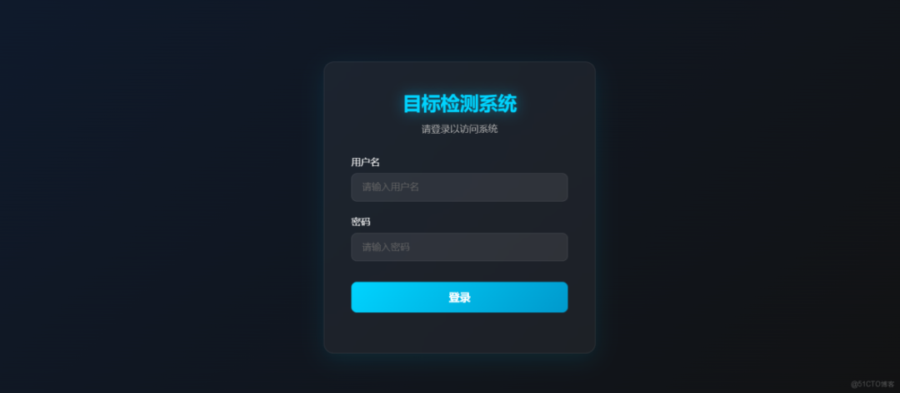
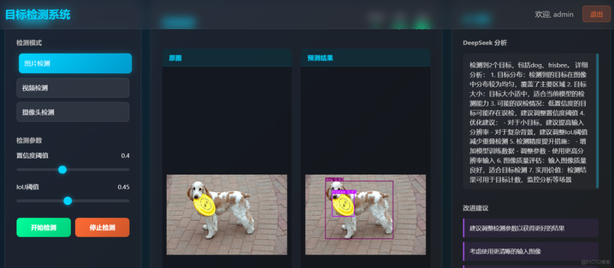

# Creating a beautifully crafted general object detection system based on yolo+django+deepseek, with a login interface supporting Yolov8, Yolov10, Yolov11, Yolov12, Yolov13, and the Yolov26 series frameworks.

A YOLO11-based object detection system, supporting image, video, and real-time camera detection, integrated with DeepSeek AI analysis functions.

A YOLO11-based object detection system, supporting image, video, and real-time camera detection, integrated with DeepSeek AI analysis functions.





#### Functional Characteristics

-

Image target detection

-

Video file detection

-

Real-time camera detection

-

DeepSeek AI intelligent analysis

-

Adjustable detection parameters (confidence, IoU)

-

Beautiful user interface

#### Install Dependencies

```
pip install -r requirements.txt
```

#### Database Migration

```
python manage.py makemigrations
python manage.py migrate
```

#### Running Projects

```
python manage.py runserver
```

Visit http://127.0.0.1:8000

#### Default login information

-

Username: admin

-

Password: admin

#### Project Structure

```
yolo11-django-deepseek-det-system/
├── manage.py               # Django management script
├── yolo_detection/ # Project configuration directory
│   ├── __init__.py
├── settings.py # Project settings
├── urls.py # Main URL configuration
└── wsgi.py # WSGI configuration
├── detection/  # Detection Application
│   ├── __init__.py
├── apps.py # Application configuration
├── forms.py
├── models.py
├── urls.py # Application URL configuration
└── views.py # View functions
├── templates/ # Template directory
├── index.html # Main page
└── login.html # Login Page
├── static/  # Static file directory
├── media/ # Media file directory
└── uploads/ # Upload Files Directory
├── requirements.txt  # Dependency list
└── yolo11n.pt  # YOLO11 model file
```

#### Technology Stack

-

Django 4.2+

-

YOLO11 (Ultralytics)

-

OpenCV

-

DeepSeek API

-

Chart.js

-

HTML5/CSS3/JavaScript

#### Notes

-

Ensure that the `yolo11n.pt` model file is located in the project root directory.

-

DeepSeek API key needs to be configured in `settings.py`

-

Recommend using Python 3.8+


## Payment

Here is a pay link on Stripe ( https://buy.stripe.com/3cs8yP7sY87d0vu9AB ). Please contact me lonlonago@foxmail.com after funding $89, and I will send you a complete data files , thank you!


